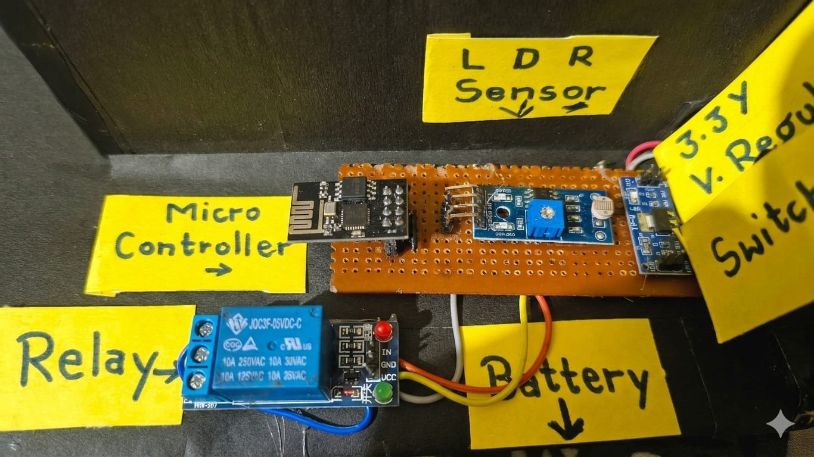
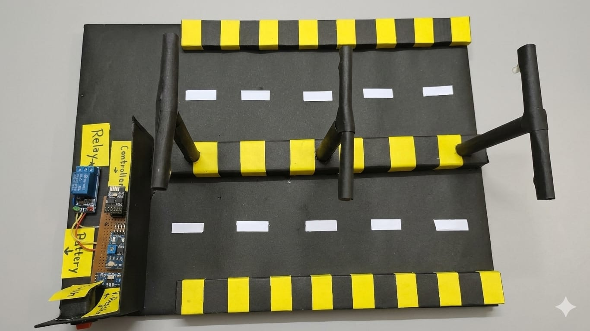

# Automatic Street Light with ESP-01, LDR and WiFi Control

A street light that switches ON in the dark and OFF in daylight using an LDR module, and can also be forced ON or OFF from a phone over WiFi using an ESP-01 (ESP8266).

**Team:** Akshat Awasthi, Rudra Pratap, Sarvesh Chaudhary, Udit Singh
**University:** Shri Ramswaroop Memorial University

## Project Structure
```
Automatic-Street-Light/
├── street_light/
│   └── street_light.ino                  Arduino code for the ESP-01
├── images/
│   ├── hw_circuit.jpg                    Labelled circuit photo
│   └── hw_model.jpg                      Working model photo
├── Automatic_Street_Light_Report.pdf     Project report
├── demo_video.mp4                        1-minute demo video
└── README.md                             This file
```

## Components
ESP-01 (ESP8266), LDR module, relay module (active-LOW), 3.3 V regulator, battery, LEDs with resistors, CP2102 USB-serial adapter, 100 µF capacitor.

## Connections
| From | To | Note |
|---|---|---|
| Battery + | 3.3 V regulator input | Battery + also feeds the relay supply and the LED load |
| Battery − | Regulator GND, ESP-01 GND, LDR GND, relay GND | Common ground |
| Regulator 3.3 V output | ESP-01 VCC and CH_PD (EN) | CH_PD must be HIGH |
| Regulator 3.3 V output | LDR module VCC | |
| LDR module DO | ESP-01 RX (GPIO3) | HIGH = dark, LOW = daylight on this module |
| LDR module AO | Not connected | ESP-01 has no analog input |
| ESP-01 GPIO2 | Relay IN | Active-LOW relay |
| Relay COM | Battery + (through the LED resistor) | |
| Relay NO | LED anode | LED cathode to battery − |
| ESP-01 GPIO0 | Left free (or 10 k to 3.3 V) | Keep HIGH at boot |

## How to use
1. Open `street_light/street_light.ino` in the Arduino IDE (board: Generic ESP8266 Module, 115200 baud).
2. For upload only: connect GPIO0 to GND, CP2102 TXD to ESP-01 RX, CP2102 RXD to ESP-01 TX. Disconnect the LDR DO wire and the relay wire during upload.
3. After upload, remove the GPIO0 to GND wire, reconnect everything and power the circuit.
4. On a phone, join the WiFi **StreetLight** (password `12345678`) and open `http://192.168.4.1`.
5. Use the AUTO, ON and OFF buttons.

## Photos



## Working
**Power.** When the rocker switch is turned ON, the battery supplies the 3.3 V regulator. The regulator powers the ESP-01 and the LDR module. The relay and the lamps take their supply from the battery.

**Sensing.** The LDR module compares the light level with a threshold set by its blue potentiometer. Its DO (digital output) pin goes HIGH in the dark and LOW in daylight, and is connected to GPIO3 (RX) of the ESP-01. The ESP-01 has no analog input, so the AO pin is not used.

**Control.** On start-up the ESP-01 creates its own WiFi hotspot called **StreetLight** and runs a small web server at `192.168.4.1`. The relay input is connected to GPIO2 and is active-LOW: GPIO2 LOW turns the relay ON, and the relay then connects the lamps to the battery.

**Modes** (selected from the phone page):

| Mode | Behaviour |
|---|---|
| AUTO | The lamps follow the LDR: dark (DO = HIGH) gives lamps ON, daylight (DO = LOW) gives lamps OFF |
| ON | The lamps stay ON, whatever the LDR reads |
| OFF | The lamps stay OFF, whatever the LDR reads |

**Program flow.**
1. `setup()` sets the pins, keeps the lamps OFF, starts the hotspot and the web server.
2. `loop()` handles web requests, reads the LDR and applies the selected mode.
3. `applyLight()` switches the relay only when the required state changes, so it does not click repeatedly.
4. The web page refreshes every 3 seconds and shows the mode, the sensor state (Dark or Bright) and the light state (ON or OFF).
